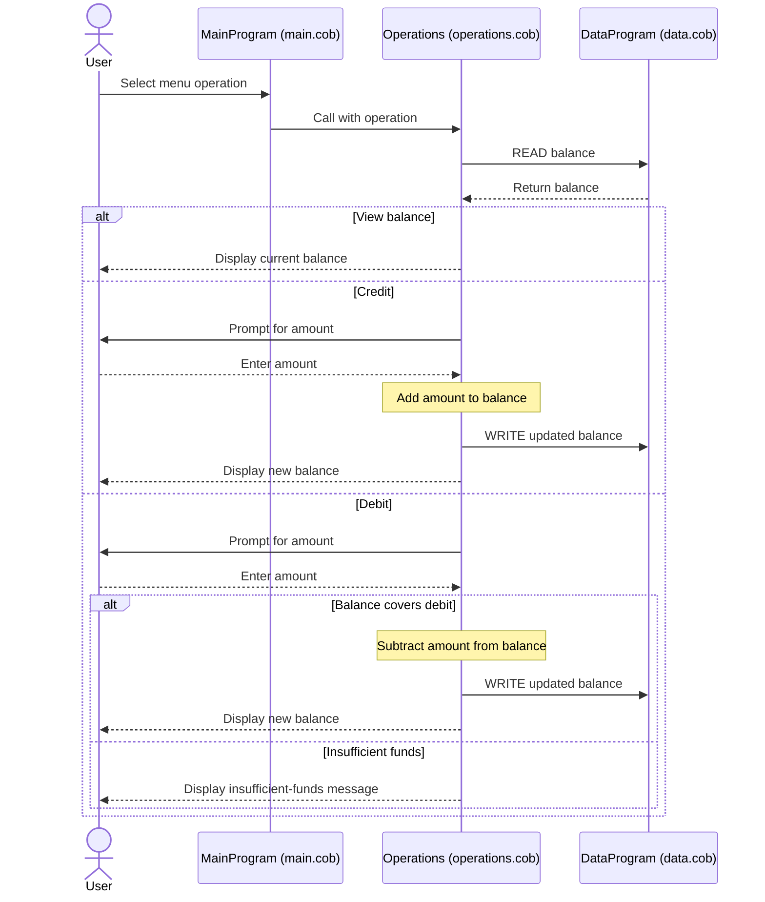

# COBOL Account Management System

This directory documents the COBOL account-management example in `src/cobol/`.
The program provides a console menu to view an account balance, credit the
account, or debit it.

## COBOL programs

### `main.cob` — `MainProgram`

Runs the console interface. It repeatedly displays the menu, accepts a
selection, and calls `Operations` with the corresponding operation:

- `1`: view the balance (`TOTAL`)
- `2`: credit the account (`CREDIT`)
- `3`: debit the account (`DEBIT`)
- `4`: exit

Other selections display an invalid-choice message and return to the menu.

### `operations.cob` — `Operations`

Implements the account operations. It reads the balance from `DataProgram`
before displaying it or changing it. For credits, it accepts an amount, adds
it to the balance, and writes the result back. For debits, it accepts an
amount, checks whether the balance is sufficient, and either subtracts and
saves the amount or displays an insufficient-funds message.

### `data.cob` — `DataProgram`

Provides the balance storage interface. A `READ` copies the stored balance to
the caller; a `WRITE` replaces the stored balance with the caller's value. The
stored balance is initialized to `1000.00`.

## Account rules and data limitations

- The initial balance is `1000.00`.
- A debit is allowed only when the current balance is greater than or equal to
  the debit amount. An insufficient-funds debit does not change the balance.
- A credit adds its entered amount to the current balance.
- Amount and balance fields use `PIC 9(6)V99`, representing up to six integer
  digits and two fractional digits.
- The code has one shared balance, with no student identifier or separate
  student accounts. “Student account” describes the exercise context; the
  COBOL implementation does not associate balances with individual students.
- The balance is held in the program's working storage and is not saved to
  durable storage, so it returns to the initial value when the program starts
  again.
- The code does not explicitly reject negative amounts or handle a balance
  exceeding the field's capacity.

## Operation flow

